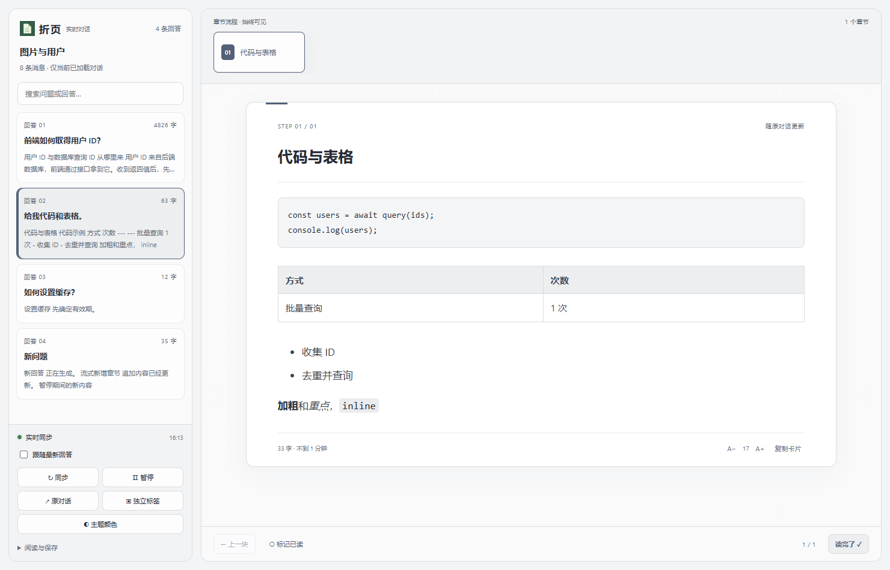
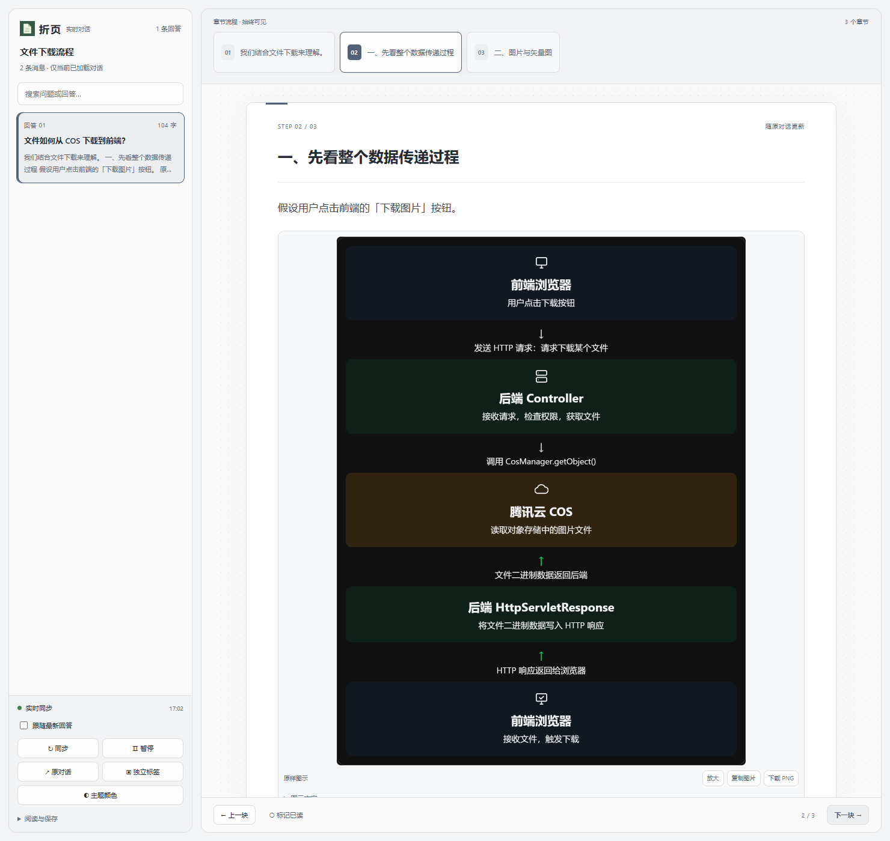
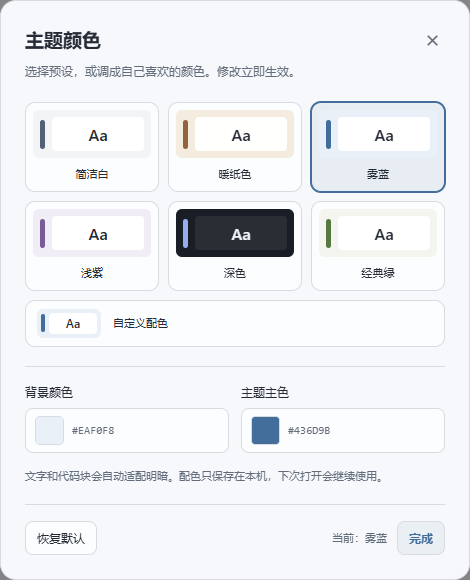

# Easy-read-airesponse

**把 ChatGPT 的长回答，拆成一张张容易阅读的卡片。**

这是一个 Chrome / Edge 桌面浏览器扩展。在打开的 ChatGPT 对话页点击扩展图标，即可读取页面已加载的对话，随回答生成实时更新，无需导出聊天文件、创建共享链接或配置 API Key。



## 功能

- **回答卡片**：每条 AI 回答独立展示，并带上对应的用户问题；支持搜索与直接切换。
- **固定章节流程**：大标题始终位于阅读框上方，正文滚动时仍可切换章节。
- **逐块阅读**：长章节继续拆成小卡片，支持短 / 适中 / 长三种长度；代码、表格和列表尽量完整保留。
- **实时同步**：回答生成过程中持续更新；默认保留正在阅读的回答、卡片和滚动位置，可开启“跟随最新回答”。
- **两种窗口**：在浏览器侧栏中边聊边读，或打开独立标签获得更大的阅读空间。
- **阅读工具**：暂停与继续、字号调整、已读标记、复制单张卡片、导出当前对话 Markdown。
- **自选主题**：简洁白、暖纸色、雾蓝、浅紫、深色、经典绿六种预设，也可自选背景色与主题主色；文字、代码块和表格自动适配明暗。
- **原样图示**：对话里的常见流程图、SVG 和可读取图片保留为本地 PNG 图块，支持放大、原尺寸查看、复制图片和下载；图示内部文字仍可搜索。

## 图示格式保留（v1.2.1）

原来会变成多行文字的彩色流程图，现在会保留卡片、箭头、图标、布局与配色，作为一个整体放在对应章节中。点击图片放大，下方可直接“复制图片”或“下载 PNG”，也能展开“图示文字”。阅读器主题只改变外围界面，图示继续使用原对话的颜色。



图示在本机转为静态图片，不截取整个网页、不发送到服务器，也不会执行复制内容中的脚本或请求其中的外部资源。Markdown 复制及导出会内嵌已复制的图示数据。

v1.2.1 修复了图内各面板被单独标为 Markdown 时，只读出文字、把一张流程图拆成两部分的问题。现在优先保留完整外框，在扩展阅读器中生成 PNG，避免原网页的图片加载策略阻止转换。回归测试覆盖嵌套流程图和禁止加载 data 图片的原网页，并确认最终图片实际显示、整图只占一张阅读卡片。

只处理当前页面已加载且可读取的内容。尚未加载、受跨域限制、嵌在不可访问框架中或过于复杂的内容，会保留说明和可读取文字，提示回原对话查看；部分自定义字体、动画或特殊布局可能无法完全还原。

## 主题颜色（v1.1.0）

点击阅读器底部的 **“◐ 主题颜色”**，选择预设，或点击“背景颜色”“主题主色”的色块自定义。配色立即生效、自动保存，侧栏与独立标签同步更新；“恢复默认”可回到简洁白。默认主题已从浅绿色改为中性白。



## 安装

1. 从 [Releases](https://github.com/sundeyao/Easy-read-airesponse/releases/latest) 下载扩展 ZIP，解压后找到包含 `manifest.json` 的 `Easy-read-airesponse` 文件夹。也可以下载本仓库源码，直接使用其中的 `extension` 文件夹。
2. 在 Chrome 地址栏打开 `chrome://extensions`；Edge 打开 `edge://extensions`。
3. 开启“开发者模式”，点击“加载已解压的扩展程序”，选择上述文件夹。
4. 在浏览器扩展菜单中将折页固定到工具栏，打开 ChatGPT 对话，再点击折页图标。

扩展名称为 **折页 · ChatGPT 卡片阅读**。当前版本为 **v1.2.1**，可本地加载，尚未上架扩展商店。需要支持侧边栏 API 的 Chrome 116+ 或相应 Edge 版本，不支持 Firefox、Safari 或手机浏览器。

## 如何使用

宽窗口中，左侧选择一条 AI 回答，顶部选择章节；窄侧边栏中，回答入口改为顶部横向卡片。正文区独立滚动，不会带走章节流程。长章节可用小卡片编号或底部上一块 / 下一块继续阅读。

全局工具位于底部。开启“跟随最新回答”后，会切换到最新回答；手动选择旧回答会关闭跟随。“阅读与保存”中提供拆分长度、Markdown 导出、清空和诊断信息。

快捷键：`←` / `→` 切换卡片，空格切换已读标记。输入框聚焦时不接管这些按键。

## 读取范围与隐私

- **只连接一个已授权的标签页**：点击工具栏图标时，通过 `activeTab` 获得当前 ChatGPT 页面的临时访问权限。在另一个 ChatGPT 标签页点击图标，会切换连接。
- **只读取页面已加载的消息**：支持 `chatgpt.com`、旧域名 `chat.openai.com` 及共享对话页，不会遍历账号中所有未打开的聊天。长对话可能采用虚拟滚动，未挂载到页面的历史内容无法保证完整读取；可以先在原页面加载需要的部分。
- **本机处理**：扩展代码不向服务器发送对话，不读取 Cookie 或登录令牌，不调用私有历史 API，不读取输入框草稿，不自动请求消息中的远程图片。
- **会话暂存**：当前对话和阅读进度使用 `chrome.storage.session`，浏览器会话结束或扩展停用后清除；字号、卡片长度和跟随开关只保存在本机。需要长期保留时，请自行导出 Markdown。
- **非文字内容**：常见流程图、SVG、Canvas 和浏览器允许读取的已加载图片在本机生成静态 PNG。图示尺寸和体积有限制，避免占满浏览器会话存储；不可读取的图片、附件或复杂交互内容显示占位说明，请回原对话查看。

权限仅为 `activeTab`、`scripting`、`storage`、`sidePanel`，没有全站访问、Cookie 或网络拦截权限。

## 常见问题

### 已连接，但显示 0 条回答

v1.0.1 补充了新版登录页面的搜索单元、对话分组和正文标记识别，并保留旧版及共享页面的读取。没有识别到消息时，会显示“未识别消息”并继续观察页面变化。

更新后请依次：**重新加载扩展 → 刷新 ChatGPT 原对话页 → 再次点击扩展图标**。若从解压目录安装，先用新版文件替换旧文件。设置中可以检查版本号。

仍为空时，可以使用“复制诊断信息”提交问题。诊断信息包含版本、连接状态、布局和消息数量，以及当前回答的图示数量、实际显示数量和转换失败类型，不含聊天正文、对话标题、URL 或账号信息。ChatGPT 页面结构可能继续变化，兼容性需要随之维护。

### 为什么不能一次读取所有聊天？

扩展读取的是选中页面已经加载的内容，没有账号全量历史读取功能。需要阅读另一个聊天时，先在 ChatGPT 中打开它，再点击扩展图标。

## 本地开发

浏览器直接加载 `extension/` 即可使用，不需要 Node.js、构建或远程服务。

需要打包或运行测试时，使用 Node.js 20+：

```sh
npm ci
npm run build
```

安装包生成在 `releases/Easy-read-airesponse-v1.2.1.zip`。浏览器侧脚本与 Markdown 渲染依赖均已包含在 `extension/` 中，构建不依赖其他项目目录。

```sh
npm run install:browser
npm test
```

测试使用隔离的 Chromium 浏览器资料和模拟对话，不连接日常浏览器、不读取真实账号。先原样加载发布版本验证未授权页面不可注入，再通过临时测试副本对模拟的 ChatGPT 页面验证实时同步、卡片导航、暂停、会话切换、旧版及新版布局和诊断信息。测试授予的站点权限与测试入口不会进入分发包。

自动测试不等于真实账号页面验证；ChatGPT 的灰度布局和真实登录页面仍需安装后确认。截图来自模拟对话。

## 目录

```text
extension/          可直接加载的 Manifest V3 扩展
scripts/build.mjs   打包脚本
tests/              隔离浏览器测试与模拟页面
docs/images/        使用模拟对话生成的界面预览
```

第三方依赖：marked 15.0.12、DOMPurify 3.4.18（浏览器渲染），fflate 0.8.3（打包），Playwright Core 1.56.1（测试）。浏览器依赖的许可证位于 `extension/vendor/`。
